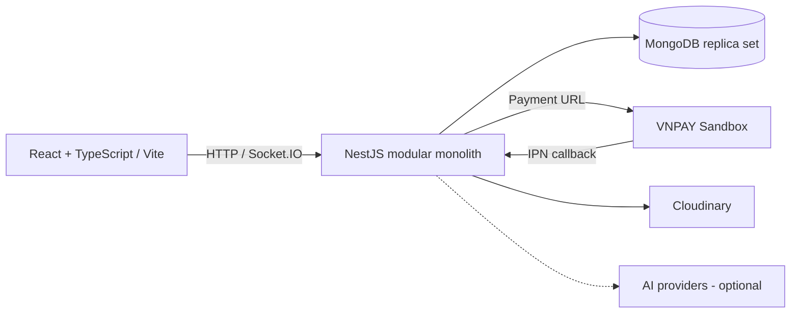

# SmartOrder — Restaurant QR Ordering

## 1. Project overview

SmartOrder là hệ thống gọi món tại bàn bằng QR, kết nối khách hàng, bếp, phục vụ và quản lý trong cùng một luồng. Project tập trung vào tính nhất quán khi nhiều người cùng sửa giỏ hàng, gửi đơn, chuyển bàn hoặc nhận callback thanh toán.

**Stack:** React · TypeScript · Vite · NestJS · Mongoose/MongoDB · Socket.IO · VNPAY Sandbox · Cloudinary. Backend là modular monolith; frontend và backend build thành hai image riêng.

## 2. Problem solved

Một bàn có thể gọi nhiều lượt, nhiều thiết bị cùng thêm món và thanh toán trong lúc nhân viên đang cập nhật đơn. Mất kết nối hoặc gửi lại request không được gây tạo đơn trùng, thanh toán hai lần hay hiển thị trạng thái cũ. SmartOrder xử lý các tình huống này từ database transaction đến HTTP và realtime UI.

## 3. Roles

| Vai trò | Công việc chính |
| --- | --- |
| Customer | Quét QR, dùng giỏ chung, gửi đơn, xem tiến độ, thanh toán và xem hóa đơn |
| Kitchen | Nhận đơn, cập nhật tiến độ chế biến |
| Waiter | Theo dõi món sẵn sàng, xác nhận phục vụ, thao tác bàn/phiên |
| Admin | Quản lý menu, bàn, nhân viên; theo dõi doanh thu và hóa đơn |

Customer dùng capability theo phiên/bàn; ba vai trò nhân viên dùng JWT và kiểm tra quyền phía backend.

## 4. Main features

- Menu, shared cart và tiến độ từng món cập nhật qua Socket.IO.
- Kitchen/Waiter dashboard; chuyển bàn, ghép/tách nhóm bàn và kết thúc phiên.
- VNPAY Sandbox, theo dõi kết quả thanh toán qua HTTP, tra cứu và xuất hóa đơn PDF.
- Admin quản lý danh mục, món, nhân viên, bàn và báo cáo doanh thu; ảnh món qua Cloudinary.
- AI tùy chọn cho tìm món, xử lý ghi chú, draft nội dung món, phân tích review và truy vấn analytics; mặc định tắt trong Docker demo.

## 5. Architecture



Các module auth, session/table, order, payment và invoice giữ trách nhiệm riêng trong cùng backend. HTTP cung cấp snapshot hiện tại; Socket báo thay đổi để UI cập nhật hoặc tải lại state. MongoDB là nơi lưu trạng thái nghiệp vụ.

## 6. Core business flow

**QR → session → shared cart → order → kitchen → waiter → payment → invoice.**

Khách quét QR hợp lệ để vào phiên bàn. Khi gửi giỏ, server kiểm tra version và giá hiện tại, tạo đơn rồi mới phát event sau commit. Món đi qua `Pending → Preparing → Ready → Served`; thanh toán được backend xác nhận trước khi hiển thị `Paid` và cấp hóa đơn.

Ba bài toán kỹ thuật chính:

- **Transaction + idempotency:** retry cùng request phải trả lại đơn đã tạo, đồng thời bảo toàn giỏ mới và các thay đổi liên quan.
- **Realtime authorization + recovery:** kiểm tra quyền khi dùng Socket; sau reconnect lấy lại snapshot, xử lý event trễ và session hết hiệu lực.
- **Payment callback + concurrency:** callback có thể đến trễ hoặc lặp; checkout đồng thời không được giữ chỗ thanh toán chồng lấn hay cập nhật đơn một phần.

## 7. Technical highlights

| Phần đã implement | Cơ chế và điểm mở code |
| --- | --- |
| Atomic order creation | Transaction bao gồm order, cart, promotion và table; rollback nếu một bước thất bại. [Order service](backend/src/modules/order/order.service.ts) |
| Persistent idempotency & concurrency | Idempotency key lưu cùng order, unique index và kiểm tra `cartVersion`; hiệu lực qua nhiều instance/request. [Order schema](backend/src/modules/order/order.schema.ts) |
| Order state machine | Kiểm soát cạnh chuyển trạng thái và role; chặn ghi tiếp vào đơn Paid/Cancelled. [Transition rules](backend/src/modules/order/order-transition.rules.ts) |
| Session/table lifecycle | Transaction cho ownership bàn, move/merge/unmerge/close và cạnh tranh với tạo đơn/thanh toán. [Lifecycle regression](backend/src/modules/session/session.lifecycle.spec.ts) |
| VNPAY payment intent | Xác thực IPN, đối chiếu số tiền, giữ phạm vi order thanh toán và xử lý callback lặp; invoice bám dữ liệu settlement. [Payment service](backend/src/modules/vnpay/vnpay.service.ts) |
| Staff/customer Socket authorization | Staff lấy active/current role; customer bị giới hạn theo session/table và expiry. [Socket auth](backend/src/gateway/socket-auth.service.ts) |
| Refresh rotation/replay protection | Verify trước lookup/mutate; random `jti`, SHA-256 toàn refresh token và conditional update/CAS để chỉ một request thắng. [Auth service](backend/src/modules/auth/auth.service.ts) |
| Frontend reconnect/resync | HTTP snapshot, version guard và coalesced refresh; payment retry/backoff hữu hạn, có trạng thái unknown. [Recovery tests](frontend/test/recovery.test.mjs) |

## 8. Reliability & security improvements

- Logout revoke refresh token ở backend; frontend vẫn xóa auth state/header khi request logout thất bại. HTTP/Socket kiểm tra user active và role hiện tại.
- Integration/E2E dùng Mongo replica set tạm, database UUID riêng; guard chặn URI bên ngoài và cleanup sai database. Unit tests bị chặn kết nối Mongo.
- [CI](.github/workflows/ci.yml) chạy build/typecheck hai phía, **full backend unit suite**, integration, E2E CI suite và frontend tests; bước lỗi làm job thất bại.
- Docker chạy Mongo replica set; backend chờ writable primary và kiểm tra transaction trước startup. Image không copy `.env`; nginx hỗ trợ refresh SPA route.

## 9. Testing

Checkpoint gần nhất **12/10/2026: 833 tests pass, 0 fail, 0 skip** trên môi trường local:

| Nhóm | Kết quả | Lệnh tại thư mục tương ứng |
| --- | --- | --- |
| Full backend unit | 761 / 33 suites | `npm run test:unit` |
| Integration | 27 / 6 suites | `npm run test:integration` |
| E2E CI (app, AI audit/demo persistence) | 13 / 3 suites | `npm run test:e2e:ci` |
| Frontend | 32 tests | `npm test` |

Build/typecheck backend + frontend, `git diff --check` và Docker build/up/transaction/SPA smoke cũng pass trong checkpoint. Con số trên tính E2E CI được chọn; full legacy E2E và live AI evaluation nằm ngoài lần chạy này. Workflow đã cấu hình; chưa có kết quả GitHub Actions runner được xác minh trong checkpoint.

Để chạy lại: dùng Node 24, `npm ci` ở mỗi thư mục; cài MongoDB Server 8.x và đặt `MONGOD_BINARY` trước integration/E2E. Harness tự tạo replica set, không đọc DB ứng dụng từ `.env`. Lệnh và guard chi tiết: [backend/test/README.md](backend/test/README.md).

## 10. Docker / local setup

Yêu cầu Docker Engine/Desktop chạy Linux containers và Compose v2. Từ terminal Bash:

```bash
git clone <repository-url> smartorder
cd smartorder
cp .env.example .env
# Điền hai JWT secret ngẫu nhiên, khác nhau theo hướng dẫn trong .env.example.
docker compose up --build -d --wait
```

Thay `<repository-url>` bằng URL clone của repo này; PowerShell dùng `Copy-Item .env.example .env`. Frontend: `http://localhost:5173`; backend: `http://localhost:3000`; health: `/health`. Mongo nằm trong mạng Compose riêng.

`PUBLIC_BACKEND_URL` phải là origin trình duyệt truy cập được, dùng chung cho HTTP/Socket và được nhúng khi build frontend. Đổi URL cần rebuild. Cloudinary/VNPAY có thể để trống khi khởi động; chức năng tích hợp cần credential hợp lệ. Hướng dẫn LAN/QR, env và bootstrap: [DOCKER.md](DOCKER.md).

Nếu chạy Node trực tiếp: copy env example trong `backend`/`frontend`, cấu hình Mongo **replica set**, đặt JWT secrets và public URLs, rồi chạy `npm ci` ở mỗi thư mục; mở hai terminal cho `npm run start:dev` (backend) và `npm run dev` (frontend).

## 11. Demo setup

Docker khởi động với database mới không tự seed tài khoản/menu. Đặt `ADMIN_EMAIL` và `ADMIN_PASSWORD` trong shell, chạy lệnh bootstrap chủ động trong [DOCKER.md](DOCKER.md), rồi đăng nhập tạo staff, menu và bàn. Dùng QR được tạo từ Admin để mở Customer; mở cửa sổ riêng cho Kitchen/Waiter để thử flow nhiều vai trò. Không có tài khoản demo công khai được cung cấp trong README.

## 12. Known limitations

- Docker local/demo dùng replica set **một node**, Mongo không bật authentication và không publish cổng DB; cấu hình này không cung cấp high availability.
- VNPAY IPN cần backend URL public được đăng ký với provider. Chưa có payment reconciliation UI; HTTP verification trả unknown nếu hết retry mà chưa có kết quả xác nhận.
- QR table-entry có TTL 365 ngày; customer capability có TTL 12 giờ và kiểm tra phiên/bàn hiện tại. Chưa có cơ chế revoke riêng từng QR đã phát hành, nên một QR bị chia sẻ vẫn có thể dùng trong thời hạn nếu còn hợp lệ.
- Staff refresh fingerprint hiện lưu một giá trị/user; chưa có quản lý phiên đa thiết bị. Đăng nhập mới thay refresh token trước đó.
- AI/provider availability cần credential và cấu hình riêng; checkpoint trên sử dụng mock cho external providers. Chưa có benchmark tải hoặc cam kết năng lực phục vụ đồng thời.

## 13. Screenshots / demo

Chưa có bộ ảnh/video được chọn cho README. Các vị trí dưới đây là placeholder cho ảnh chụp ứng dụng thật:

| Asset cần bổ sung | Nội dung nên thể hiện |
| --- | --- |
| Customer menu/cart | Hai thiết bị cùng phiên bàn và tiến độ món |
| Kitchen / Waiter | Món chuyển từ chế biến sang phục vụ |
| Payment / invoice | Kết quả backend xác nhận và PDF hóa đơn |
| Demo video | Một lượt QR → order → phục vụ → VNPAY Sandbox → invoice |
